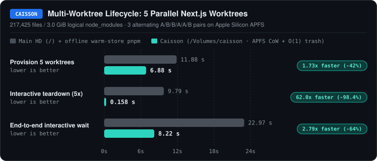
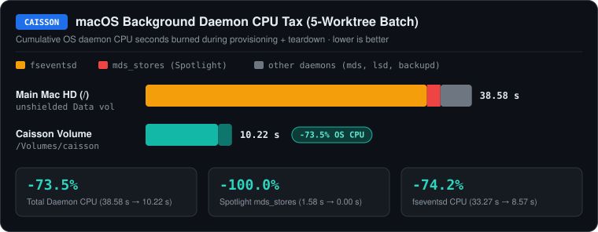
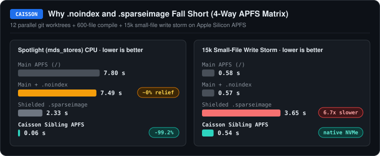
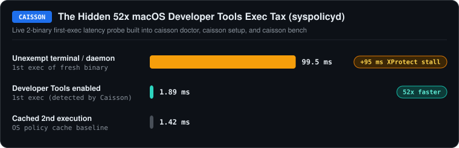
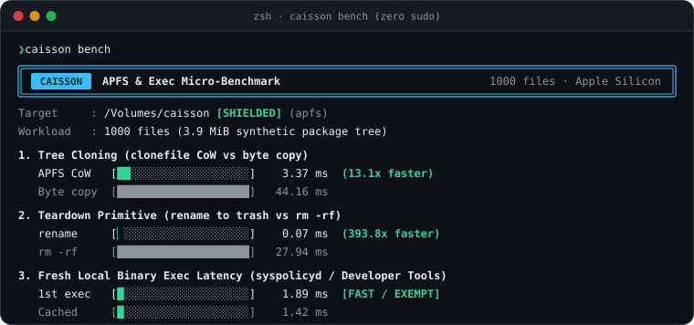
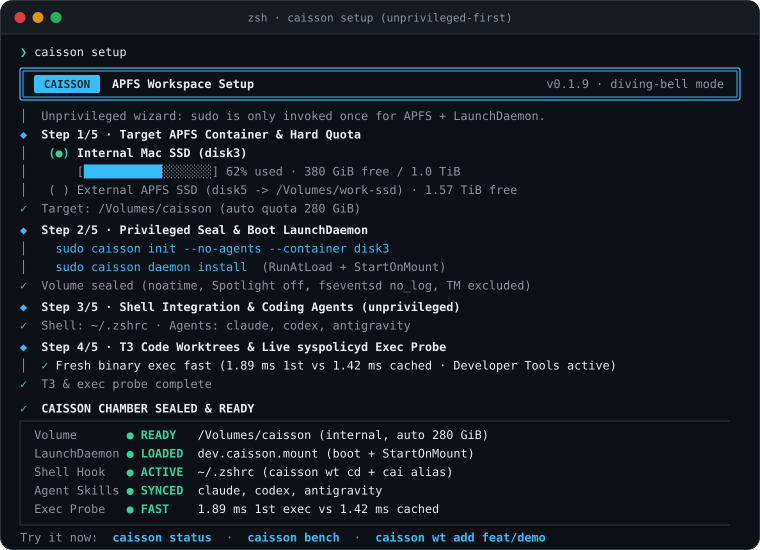
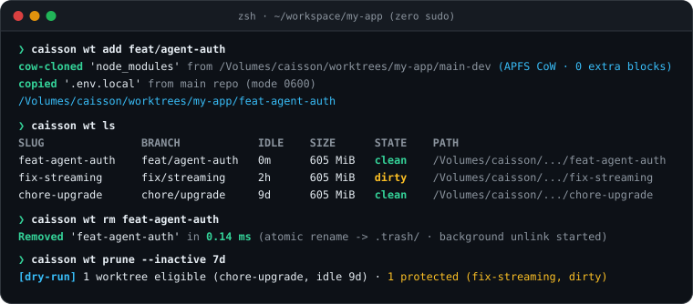

# Caisson

**Daemon-shielded sibling APFS developer workspaces and instant Copy-on-Write git worktrees for macOS, written in Rust.**

[](https://github.com/beckhq/caisson/actions/workflows/ci.yml)
[](https://github.com/beckhq/caisson/releases/latest)
[](./LICENSE)
[](#why-caisson)

> **The native macOS APFS workspace engine, purpose-built for parallel AI coding agents and heavyweight builds.**
>
> Born while building the **Refactor** browser at [BeckHQ](https://github.com/beckhq), where running dozens of parallel coding agents alongside multi-gigabyte Chromium builds pushed macOS Spotlight (`mds_stores`), `fseventsd`, Time Machine local snapshots, and `rm -rf` teardown storms past their breaking point.

```bash
brew install beckhq/tap/caisson
caisson setup
```

**Why "Caisson"?** In civil engineering, a *caisson* is a watertight retaining chamber sunk below water or soft ground so crews can construct foundations in dry, isolated conditions without fighting the surrounding pressure. Caisson does the same thing on macOS: it carves out a native, daemon-shielded APFS chamber inside your internal (or external) SSD so builds and coding agents run at full NVMe speed, isolated from Spotlight, `fseventsd`, and Time Machine pressure.

---

## Benchmarks & Real Measurements

Every number below comes from controlled Apple Silicon APFS benchmarks (never synthetic best-cases without a real baseline). Want to verify CoW cloning, teardown, and `syspolicyd` latency on your own Mac right now? Run `caisson bench` (zero `sudo`).

### 1. Parallel Agent Worktrees: 62x Faster Teardown, 2.8x Faster End-to-End

Spinning up parallel AI coding agents (`claude`, `codex`, `t3-code`, `cursor`) on Node/TypeScript monorepos means cloning and deleting tens of thousands of `node_modules` files over and over. On your main Mac HD (`/`), even a best-case offline warm-store `pnpm install` + `git worktree remove` leaves you waiting ~23 seconds per 5-worktree wave.

Caisson uses native Darwin `clonefile(2)` Copy-on-Write cloning on a shielded sibling APFS volume and `<1 ms` atomic rename-to-trash teardown, cutting interactive teardown from **9.79 s to 0.158 s (62x faster)** and end-to-end interactive wait from **22.97 s to 8.22 s (2.79x faster)**.

<picture>
  <source media="(prefers-color-scheme: dark)" srcset="./docs/assets/bench-worktrees-dark.svg" />
  <source media="(prefers-color-scheme: light)" srcset="./docs/assets/bench-worktrees-light.svg" />
  
</picture>

<details>
<summary>View full raw benchmark table &amp; alternating A/B methodology</summary>

Measured across 3 alternating pairs (`A/B/B/A/A/B`, 6 runs, 30 worktrees total) on Apple Silicon APFS using a real Next.js/TypeScript dependency tree (**43,485 files / 605 MiB logical `node_modules`** per worktree = **217,425 files / 3.0 GiB logical** per 5-worktree batch). The baseline uses offline warm-store `pnpm install --offline --frozen-lockfile --ignore-scripts` (best-case zero-network package manager) on `/` and standard `git worktree remove --force`:

| Metric (5 worktrees x 43,485-file `node_modules`) | Main HD (`/` + offline `pnpm`) | **Caisson (`/Volumes/caisson`)** | Delta |
| :--- | ---: | ---: | ---: |
| **Provision 5 worktrees** | 11.88 s *(11.87-12.11 s)* | **6.88 s** *(5.80-7.03 s)* | **1.73x faster (-42.1%)** |
| **Interactive teardown (5 worktrees)** | 9.79 s *(9.70-10.37 s)* | **0.158 s** *(0.154-0.168 s)* | **62.0x faster (-98.4%)** |
| **End-to-end interactive wait** | 22.97 s *(22.85-23.43 s)* | **8.22 s** *(7.15-8.39 s)* | **2.79x faster (-64.2%)** |
| **End-to-end incl. full `gc` unlink drain** | 22.97 s | **13.26 s** *(12.40-13.44 s)* | **1.73x faster (-42.3%)** |
| **Total macOS daemon CPU** | 38.58 s *(37.71-39.67 s)* | **10.22 s** *(10.10-10.28 s)* | **-73.5%** |
| **`fseventsd` CPU** | 33.27 s | **8.57 s** | **-74.2%** |
| **`mds_stores` CPU** | 1.58 s | **0.00 s** | **-100.0%** |
| **Physical APFS disk delta (3.0 GiB logical)** | 120.9 MiB | **88.2 MiB** | **-27.0% metadata overhead** |

</details>

---

### 2. The Hidden macOS Background Daemon Tax: -73.5% OS CPU

Even when a worktree command finishes, macOS keeps burning CPU behind your back. During that exact same 5-worktree batch on `/`, macOS background daemons burned **38.58 CPU-seconds** indexing and logging every file you just created and deleted.

By isolating workspaces behind a shielded sibling APFS volume (`mdutil -i off`, `.metadata_never_index`, `.fseventsd/no_log`, `tmutil addexclusion`, `noatime`, `.Trashes` blocker), Caisson eliminates **100% of Spotlight (`mds_stores`) CPU** and cuts total background daemon CPU by **73.5%**.

<picture>
  <source media="(prefers-color-scheme: dark)" srcset="./docs/assets/bench-daemons-dark.svg" />
  <source media="(prefers-color-scheme: light)" srcset="./docs/assets/bench-daemons-light.svg" />
  
</picture>

---

### 3. Why `.noindex` and `.sparseimage` Don't Work

The two most common macOS build-speed workarounds fail under real file-churn storms:

- **`.noindex` on `/` gives ~0% relief:** Spotlight's `mds_stores` still burned **7.49 s vs 7.80 s** (within noise), because directory-level exclusions on the root Data volume do not stop FSEvents/Spotlight churn at the volume boundary.
- **`.sparseimage` destroys small-file I/O:** Wrapping a build in an APFS-on-APFS sparse image slowed 15k small-file writes by **6.7x** (`3.65 s` vs `0.54 s`) and parallel worktrees by **3.1x**.
- **Sibling APFS volume** gets **both**: native kernel NVMe speed (`0.54 s`) and **-99.2% Spotlight CPU** (`0.06 s`).

<picture>
  <source media="(prefers-color-scheme: dark)" srcset="./docs/assets/bench-matrix-dark.svg" />
  <source media="(prefers-color-scheme: light)" srcset="./docs/assets/bench-matrix-light.svg" />
  
</picture>

<details>
<summary>View full 4-way storage strategy matrix table</summary>

Measured across a 4-way matrix on Apple Silicon APFS (12 parallel git worktrees + dependency cloning + 600-file compile + 15k small-file write storm + teardown):

| Storage Strategy | `mds_stores` CPU | Total Daemon CPU | 12x Worktrees | 15k Small Files | Teardown | End-to-End Wall |
| :--- | ---: | ---: | ---: | ---: | ---: | ---: |
| Main APFS (default) | 7.80 s | 36.93 s | 2.47 s | 0.58 s | 7.64 s (`rm -rf`) | 28.36 s |
| Main APFS + `.noindex` | 7.49 s | 37.82 s | 2.41 s | 0.57 s | 7.83 s (`rm -rf`) | 27.15 s |
| Shielded `.sparseimage` | 2.33 s | 18.51 s | 6.99 s *(3.1x slower)* | 3.65 s *(6.7x slower)* | 0.45 s | 33.53 s |
| **Caisson (Sibling APFS)** | **0.06 s (-99.2%)** | **14.47 s (-60.8%)** | **2.26 s** | **0.54 s** | **1.44 s (O(1))** | **20.56 s (-27.5%)** |

</details>

---

### 4. Bonus Discovery: Catching the 52x `syspolicyd` / Developer Tools Exec Tax

Even on a fast SSD, macOS `syspolicyd` / XProtect can stall the **first execution** of every freshly compiled local binary (Rust tests, C/C++ build tools, Go tests, Swift binaries) by **+85 to +150 ms** if your terminal or background IDE/agent server is missing the **Developer Tools** exemption.

`caisson doctor`, `caisson setup`, and `caisson bench` include a built-in **~150 ms zero-`sudo` 2-binary exec probe** that measures real first-exec vs cached latency and walks your process tree to name the exact responsible ancestor process.

<picture>
  <source media="(prefers-color-scheme: dark)" srcset="./docs/assets/bench-syspolicyd-dark.svg" />
  <source media="(prefers-color-scheme: light)" srcset="./docs/assets/bench-syspolicyd-light.svg" />
  
</picture>

> [!TIP]
> Run `caisson doctor` right after installing. If it flags `SYSPOLICYD_EXEC_TAX`, enable your terminal/IDE in **System Settings -> Privacy & Security -> Developer Tools** to drop first-exec latency from ~95 ms to ~1.9 ms.

---

### 5. Verify on Your Own Mac in 2 Seconds (`caisson bench`)

Every install includes a zero-`sudo`, self-cleaning APFS & exec micro-benchmark so you can measure real speedup on your own internal or external SSD:

<picture>
  <source media="(prefers-color-scheme: dark)" srcset="./docs/assets/cli-bench-dark.svg" />
  <source media="(prefers-color-scheme: light)" srcset="./docs/assets/cli-bench-light.svg" />
  
</picture>

---

## Why Caisson?

When you run parallel coding agents (`git worktree`) or heavy C++/Rust/Xcode/Chromium builds on the default macOS Data volume, macOS fights your filesystem on five fronts:

1. **Spotlight indexing churn (`mds` / `mds_stores`):** Directory exclusions like `.noindex` and `.metadata_never_index` on `/` provide **~0% CPU relief** during high-frequency write storms.
2. **`fseventsd` log & memory bloat:** Sustained build and worktree churn writes massive logs to `/.fseventsd` and can bloat `fseventsd` to gigabytes of RSS and swap.
3. **Time Machine local snapshots:** Hourly local APFS snapshots on `/` pin deleted build artifacts and dead worktrees for up to 24 hours.
4. **Slow teardown & worktree sprawl:** Deleting `node_modules` or build trees via `rm -rf` takes seconds to minutes and triggers a second `fseventsd` storm; forgotten agent worktrees accumulate silently.
5. **External-drive TCC traps:** Moving builds to external Thunderbolt/USB drives triggers macOS *Removable Volumes* TCC prompts for freshly compiled ad-hoc test binaries.

**Caisson solves all five at the APFS volume boundary** by creating a native **sibling APFS volume** (`/Volumes/caisson`, on your internal Mac SSD or an external APFS SSD). It dynamically shares container free space with zero virtualization overhead, shielded from Spotlight, `fseventsd` disk logs, Time Machine, and `atime` churn.

---

## Quickstart

### 1. Install

```bash
# Homebrew (recommended, universal Apple Silicon + Intel binary)
brew install beckhq/tap/caisson

# Or from source (macOS, Rust stable)
cargo install --git https://github.com/beckhq/caisson
```

### 2. Guided One-Time Setup (`sudo` once; never needed again for worktrees)

Run the unprivileged-first interactive wizard (picks your internal Mac SSD or external APFS SSD, invokes `/usr/bin/sudo` once for volume creation + LaunchDaemon, then configures shell integration, coding agents, T3 Code, and probes `syspolicyd` latency):

<picture>
  <source media="(prefers-color-scheme: dark)" srcset="./docs/assets/cli-setup-dark.svg" />
  <source media="(prefers-color-scheme: light)" srcset="./docs/assets/cli-setup-light.svg" />
  
</picture>

```bash
# Preview everything first with zero disk changes
caisson setup --dry-run

# Run interactive guided setup
caisson setup
```

Or run the individual steps explicitly:

```bash
# Audit your Mac's daemon overhead & fresh-binary exec latency first (read-only, no sudo)
caisson doctor

# Create & shield /Volumes/caisson with an auto-computed hard APFS safety ceiling
sudo caisson init

# Optional: persist `noatime` & shields across reboots and external SSD reconnects
sudo caisson daemon install

# Wire up coding agents (unprivileged, never writes to $HOME as root)
caisson agent install

# Benchmark APFS CoW cloning, teardown, and syspolicyd latency on your Mac
caisson bench
```

### 3. Daily Zero-`sudo` Agent & Developer Worktrees

Run directly inside **any existing git repository**, with no need to move `~/workspace`:

<picture>
  <source media="(prefers-color-scheme: dark)" srcset="./docs/assets/cli-worktrees-dark.svg" />
  <source media="(prefers-color-scheme: light)" srcset="./docs/assets/cli-worktrees-light.svg" />
  
</picture>

```bash
# Create an isolated worktree on /Volumes/caisson (with instant APFS CoW dependency cloning)
caisson wt add feat/agent-auth

# Create from a specific ref or custom slug, with structured JSON for coding agents
caisson wt add fix/parser --from origin/main --name parser-v2 --json

# Hydrate an existing worktree created by T3 Code, an IDE, or `git worktree add`
caisson wt hydrate --json

# List worktrees with last-activity idle time, dirty/unpushed status, and size
caisson wt ls
caisson wt ls --all

# Jump directly into a worktree (after adding `eval "$(caisson shell-init zsh)"`)
caisson wt cd feat-agent-auth

# Remove in <1 ms (atomic rename to .trash/ + git worktree prune + detached background unlink)
caisson wt rm feat-agent-auth

# Dry-run prune of inactive worktrees (protects dirty & unpushed work by default)
caisson wt prune --inactive 7d
caisson wt prune --inactive 7d --apply

# Drain .trash/ and reconcile orphaned git worktree metadata
caisson gc
```

---

## Two-Tier Storage Architecture

```text
APFS Container (Internal Mac SSD e.g. disk3, or External APFS SSD e.g. disk5)
├── Macintosh HD / Data          (macOS system & personal files, untouched)
│
├── [Tier 1] /Volumes/caisson    (Created ONCE via `caisson setup` or `sudo caisson init`)
│   ├── .caisson-volume.json     (UUID ownership marker)
│   ├── .metadata_never_index    (Spotlight shield)
│   ├── .fseventsd/no_log        (Disable persistent fseventsd disk logs)
│   ├── .Trashes                 (0-byte file blocking Finder trash creation)
│   ├── worktrees/<repo>/<slug>/ (All `caisson wt` worktrees, ZERO sudo!)
│   ├── cache/<repo>/            (Optional warm CoW templates for node_modules/.venv)
│   └── .trash/<uuid>/           (<1 ms atomic rename target for async unlink)
│
└── [Tier 2] /Volumes/<name>     (Dedicated volumes via `sudo caisson vol create`)
    └── Heavyweight builds (Chromium, Xcode DerivedData, ephemeral build swarms)
        • Custom hard APFS quota (`--quota 300g`)
        • Optional Case-sensitive APFS (`--case-sensitive`)
        • Instant O(1) teardown via `sudo caisson vol destroy <name>`
```

See [`ARCHITECTURE.md`](./ARCHITECTURE.md) for the complete technical specification.

---

## Repo CoW & Env Config (`.caisson.toml`)

Drop an optional `.caisson.toml` in any repository root to enable instant APFS `clonefile(2)` Copy-on-Write cloning of untracked dependency trees, opt-in `.env` file copying, and post-create hooks:

```toml
[worktree]
# Cloned in O(1) with zero extra disk blocks from warm cache, sibling worktrees,
# or same-volume main checkout via native Darwin clonefile(2) (CLONE_NOFOLLOW).
cow_copy = ["node_modules", ".venv"]

# Optional: explicitly copy non-committed regular files from the trusted main repo
# checkout into new/hydrated worktrees (enforces mode 0600 on `.env*`, never clobbers).
copy_files = [".env.local"]

# Optional shell command run inside the new worktree (`CAISSON_WORKTREE`, `CAISSON_REPO`, `CAISSON_BRANCH` set).
# For `wt hydrate`, hooks are disabled by default and require explicit `--run-post-create`.
post_create = ""
```

> [!NOTE]
> Even without `copy_files`, `caisson wt add --json` and `caisson wt hydrate --json` report `missing_env_files` (top-level `.env*` files present in your main checkout but absent from the new worktree, excluding `.env.example` / templates) without ever auto-copying secrets behind your back.

---

## Two-Layer Quotas (Hard Blast Shield + Live Soft Limits)

APFS locks hard `-quota` into the volume superblock at creation time. Caisson pairs that with **live-editable soft quotas** in `~/.config/caisson/config.toml` (zero `sudo`):

```toml
[quotas]
max_worktrees_per_repo = 25   # warn at 80%, refuse at 100% unless --force
max_worktrees_total = 50      # global cap across all repos
soft_disk_limit = "250G"      # editable anytime without recreating the volume
min_host_free = "50G"         # refuse wt add if container free space drops below 50G

[prune]
default_inactive = "7d"       # measured by last activity, never crawling node_modules
protect_dirty = true          # never prune uncommitted changes unless --include-dirty
protect_unpushed = true       # never prune unpushed commits unless --include-unpushed
```

Update live anytime:

```bash
caisson config show
caisson config set quotas.max_worktrees_per_repo 40
caisson config set quotas.soft_disk_limit 400G
```

---

## Command Reference

### Zero-`sudo` Daily Commands

| Command | Purpose |
| :--- | :--- |
| `caisson setup [--dry-run]` | Unprivileged-first VT220 onboarding wizard (drive picker, single-`sudo` seal & daemon, shell, agents, T3, exec probe) |
| `caisson bench [--files 1000] [--target <dir>]` | Self-contained APFS CoW cloning, teardown, and `syspolicyd` first-exec micro-benchmark |
| `caisson wt add <branch> [--from <ref>] [--name <slug>] [--no-cow] [--force]` | Create a shielded CoW git worktree on `/Volumes/caisson` |
| `caisson wt hydrate [--dry-run] [--fallback-install] [--run-post-create]` | Zero-config clone-only APFS CoW hydration (`node_modules` or `.caisson.toml`) with lockfile ranking & opt-in offline fallback install |
| `caisson t3 setup [--volume <name>] [--dry-run]` | Guided T3 Code Worktree location setup (`~/.t3/userdata/settings.json` with backup) |
| `caisson wt ls [--all]` | List worktrees with idle age, dirty/unpushed flags, and size |
| `caisson wt path <target>` | Print canonical path of a worktree (powers `wt cd`) |
| `caisson wt rm <target> [--force] [--sync]` | Instant `<1 ms` atomic rename to `.trash/` + async unlink |
| `caisson wt prune [--inactive 7d] [--include-dirty] [--apply]` | Reclaim inactive worktrees safely (dry-run by default) |
| `caisson gc` | Drain `.trash/` and reconcile orphaned git worktree metadata |
| `caisson clone <src> <dst>` | Native Darwin `clonefile(2)` CoW clone (`CLONE_NOFOLLOW`) |
| `caisson doctor` | Audit daemon CPU/RSS (`fseventsd` bloat), snapshots, swap, shields, daemon binary drift, and live `syspolicyd` exec tax |
| `caisson watch --label <name> --out <jsonl> [--watch-pid <pid>]` | Passive build telemetry sampler (`JSONL` + `.summary.json`) |
| `caisson status` / `caisson vol ls` | Inspect container capacity, volumes, shields, and daemon state |
| `caisson config show \| get \| set` | View or live-edit soft quotas without `sudo` |
| `caisson agent status \| install \| update \| uninstall \| dismiss \| snippet` | Wire up & auto-sync coding agents (Claude Code, Codex, Antigravity, Cursor, OpenCode, Windsurf) |
| `caisson completions <zsh\|bash\|fish>` | Generate shell completions |
| `caisson shell-init <zsh\|bash\|fish> [--alias cai]` | Enable `caisson wt cd <slug>` shell navigation |

Every command supports `--json` for coding agents, scripts, and menu-bar companion apps.

### Privileged Administrative Commands (`sudo`)

| Command | Purpose |
| :--- | :--- |
| `sudo caisson init [--on /Volumes/<ssd>] [--quota auto\|<size>\|none] [--case-sensitive] [--dry-run]` | Create & shield Tier-1 `/Volumes/caisson` once (internal or external APFS container) |
| `sudo caisson vol create <name> [--on /Volumes/<ssd>] [--quota 300g] [--case-sensitive] [--nobrowse]` | Create & shield a dedicated Tier-2 build volume |
| `sudo caisson vol shield <name>` | Idempotently re-apply all 7 daemon shields |
| `sudo caisson vol destroy <name> [--yes] [--dry-run]` | O(1) delete a Caisson volume (**triple-checked safety guard**) |
| `sudo caisson daemon install \| uninstall` | Manage one-shot boot LaunchDaemon (`dev.caisson.mount`) |
| `sudo caisson mount-all` | Mount & re-apply `noatime` / shields on registered volumes |

---

## Coding Agent Integration

Caisson ships an official Agent Skill ([`skills/caisson/SKILL.md`](./skills/caisson/SKILL.md)) embedded right inside the binary so Claude Code, OpenAI Codex, Antigravity (AGY), Cursor, OpenCode, and Windsurf automatically prefer `caisson wt` over raw `git worktree` on `/`.

```bash
# Detect installed agents and install SKILL.md interactively (unprivileged)
caisson agent install

# Check installed vs detected coding agents
caisson agent status

# Print a concise snippet for any repository's AGENTS.md / CLAUDE.md
caisson agent snippet
```

Run `caisson setup` or `caisson agent install` (never as `root`) to install skills cleanly into `$HOME`. After future `brew upgrade` updates, unmodified installed skills automatically refresh to the new binary's embedded `SKILL.md` on your next mutating `caisson` run (hand-edited skills are never overwritten unless you pass `caisson agent update --force`).

### T3 Code & External Worktree Managers

For host-managed worktree tools like **T3 Code**:
1. Run `caisson setup` or `caisson t3 setup --dry-run` (or open **T3 Code -> Settings -> Worktrees -> Worktree location** and point it to `/Volumes/<your-caisson-volume>/t3-worktrees`).
2. *(Optional, for JS/TS repos)* Open **Project Settings -> Scripts**, add `caisson wt hydrate`, and enable **"Run when creating a worktree"**. No `.caisson.toml` is required for `node_modules` repos (add `.caisson.toml` for custom `cow_copy` paths or opt-in `copy_files`), and Caisson ranks sibling donors by lockfile match (`pnpm-lock.yaml`, `package-lock.json`, `yarn.lock`, `bun.lock`) while keeping default hydration strictly clone-only.
3. Run `sudo caisson daemon install` once (and re-run it after upgrading `caisson` to refresh the root-owned daemon binary and plist); `dev.caisson.mount` uses `RunAtLoad` + `StartOnMount` so shields and `noatime` persist across reboots and external SSD reconnects.

---

## Shell Integration

Add to `~/.zshrc` (or `~/.bashrc` / `~/.config/fish/config.fish`), or let `caisson setup` append it for you:

```zsh
eval "$(caisson shell-init zsh --alias cai)"
eval "$(caisson completions zsh)"
```

Now you can jump directly into worktrees with `caisson wt cd <slug>` or `cai wt cd <slug>`.

---

## Safety Guarantees

> [!IMPORTANT]
> Caisson treats destructive disk operations with extreme conservatism and enforces a strict privilege boundary (`root` never writes into `$HOME`).

1. **Triple-checked `destroy`:** Refuses to delete any volume unless **all three** match independently:
   - Volume UUID is registered in `/Library/Application Support/caisson/registry.json`,
   - Live APFS volume has **no protected system role** (`System`, `Data`, `VM`, `Preboot`, `Recovery`, etc.) and is not mounted under `/` or `/System/*`, **AND**
   - Mounted volume root contains `.caisson-volume.json` with `managed_by == "caisson"` and an exact UUID match.
2. **Explicit confirmation:** Interactive volume-name confirmation or `--yes` required (re-verified after the prompt).
3. **Dry-run everywhere:** `--dry-run` prints every privileged command without mutating disk.
4. **Zero persistent root daemon:** The boot LaunchDaemon runs once (`RunAtLoad = true`, `StartOnMount = true`, `KeepAlive = false`) and exits immediately.
5. **Structured APFS parsing:** Always parses `diskutil ... -plist` structurally via `plist`, never fragile text regexes.

---

## Contributing & License

- Contributions welcome! See [`CONTRIBUTING.md`](./CONTRIBUTING.md) and [`ARCHITECTURE.md`](./ARCHITECTURE.md).
- Security disclosures: [`SECURITY.md`](./SECURITY.md).
- Licensed under the [MIT License](./LICENSE).
